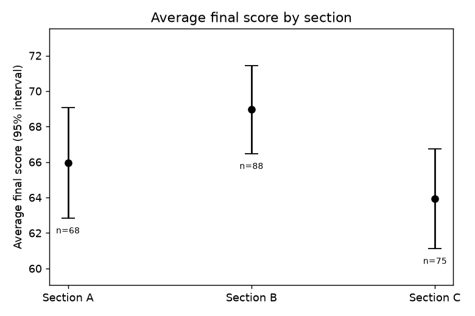
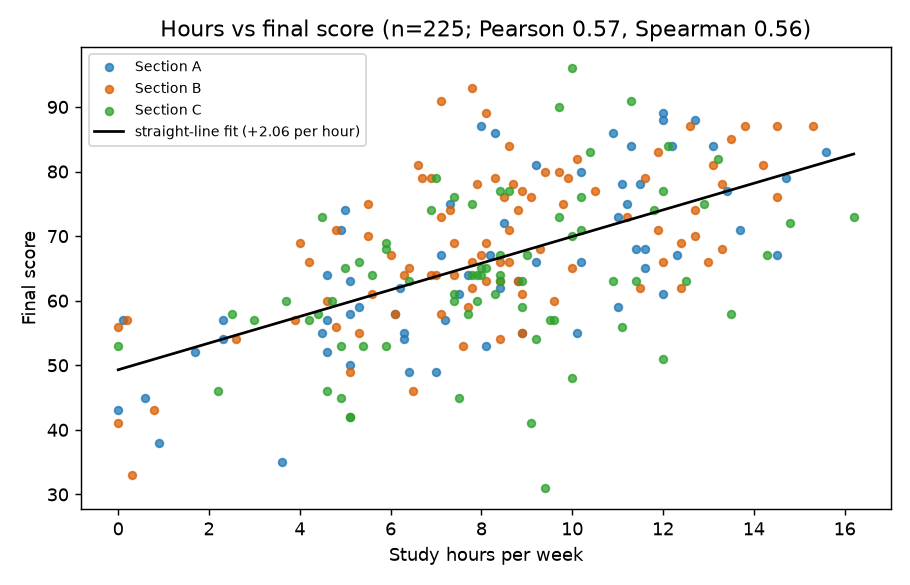
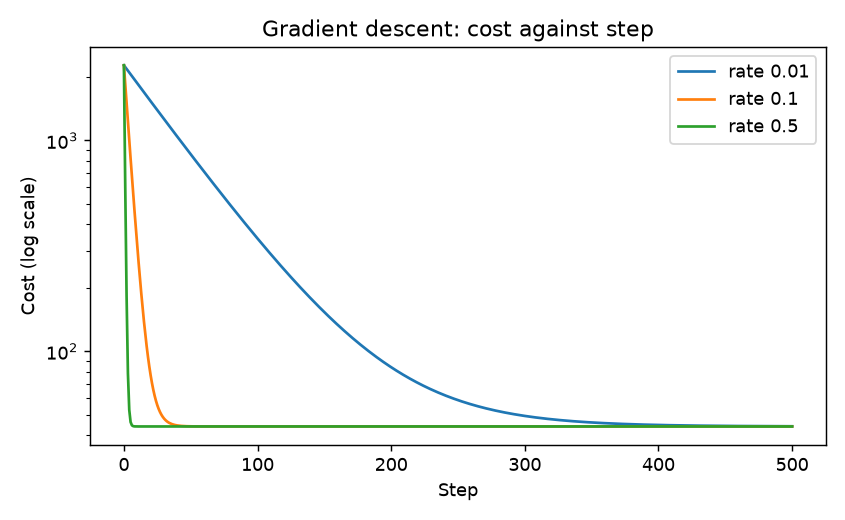

# Do extra study hours help, and does the section matter?

## The answer (one page)

- **Hours: yes, they go together.** Students who study more hours tend to have a higher final score (Pearson 0.57, 95% interval 0.48 to 0.65; Spearman 0.56). With the starting level (prior score) taken into account, one more weekly hour goes with about 1.72 more points (95% interval 1.44 to 1.99).
- **But this is not proof that extra hours CAUSE higher scores.** Nobody was told to study more. Students who started stronger may study more (hours vs prior: Pearson 0.20). The prior-adjusted number above reduces that problem, it does not remove it.
- **Section: no clear sign that it matters (yet).** The averages differ a little (ANOVA p = 0.032), but after correcting for the 4 tests that were run the evidence is not strong enough (corrected p = 0.063). For the one pair chosen in advance, A minus B is -3.0 points (95% interval -7.0 to 0.9). An interval that includes 0 means 'we cannot tell', not 'no difference'.

Based on 231 students out of 247 rows in the raw file. Everything below shows how that number was reached and what could not be checked.

### Average final score by section (95% interval)

| section | n | mean_final | sd | ci_low | ci_high |
|---|---|---|---|---|---|
| A | 68 | 66.0 | 12.9 | 62.8 | 69.1 |
| B | 88 | 69.0 | 11.7 | 66.5 | 71.5 |
| C | 75 | 63.9 | 12.2 | 61.1 | 66.7 |

### Hours against final score

- Pearson (straight-line link) 0.57, 95% interval 0.48 to 0.65
- Spearman (ranks, not bothered by odd values) 0.56, 95% interval 0.46 to 0.65 (bootstrap)
- Students with both numbers: 225

## What was found and fixed (every number is a count)

Raw file: **247** rows. It was read as text and never changed (sha256 `bf8cfc6aec5ee8f9...` checked before and after).

| action | count | why | examples |
|---|---|---|---|
| repeat rows removed (exact copy) | 6 | same student id and same numbers | S055, S214, S174, S079, S013 |
| repeat rows removed (different numbers) | 1 | same student id, different numbers; first row kept | S074 |
| hours: text | 4 | number written with a unit, like '12 hrs' or '78%' | S199, S166, S059, S043 |
| hours: word | 5 | number written as a word, like 'ten' | S207, S002, S188, S196, S190 |
| hours: gap | 3 | empty / NA / n/a: left as a gap | S162, S108, S156 |
| prior: gap | 3 | empty / NA / n/a: left as a gap | S211, S124, S228 |
| final: text | 7 | number written with a unit, like '12 hrs' or '78%' | S015, S055, S132, S066, S018 |
| final: gap | 8 | empty / NA / n/a: left as a gap | S142, S006, S119, S009, S177 |
| section spelling fixed | 111 | e.g. 'Sec b', ' B-' -> B | S050, S138, S015, S055, S105 |
| section unknown | 0 | could not tell the section |  |
| hours: impossible value | 3 | outside 0-100 | S168=940, S130=-3, S167=120 |
| prior: impossible value | 1 | outside 0-100 | S189=-5 |
| final: impossible value | 1 | outside 0-100 | S017=130 |
| rows removed: no usable final score | 9 | cannot study the final score without it | S142, S006, S119, S009, S177 |

### Rows that were removed (all of them, with the reason)

| reason | rows |
|---|---|
| no usable final score | 9 |
| exact repeat of an earlier row | 6 |
| same student id with DIFFERENT numbers (kept the first row, cannot know which is right) | 1 |

Check: 247 raw rows = 16 removed + 231 used. The list is in `outputs/removed_rows.csv`.

### The 940-hour row: with and without

| version | n | pearson | spearman |
|---|---|---|---|
| naive: impossible values KEPT | 229 | 0.03 | 0.54 |
| cleaned: impossible values blanked | 225 | 0.57 | 0.56 |

Keeping the impossible values moved Pearson by 0.54 and Spearman by 0.02. One huge value pulls a straight line a lot; ranks barely notice it. That is why both are reported.

## Tests run: how many, before trusting a p-value

**4 tests were run**, and they are all listed. Because several were run, each p-value is also corrected with Holm's method (`p_holm`). Trust `p_holm`, not `p`.

| test | statistic | p | p_holm |
|---|---|---|---|
| Welch t-test, section A vs B | -1.506 | 0.134 | 0.134 |
| One-way ANOVA, final by section | 3.510 | 0.032 | 0.063 |
| Pearson correlation, hours vs final | 0.572 | <0.001 | <0.001 |
| Spearman correlation, hours vs final | 0.561 | <0.001 | <0.001 |

The pair A vs B was chosen before looking at any section averages. Looking first and then testing the biggest gap would be a hidden extra test.

## Train / test split and gradient descent

- The test rows (46 students, 20%) were put away first. Train: 185 students.
- Gaps in `hours` / `prior` were filled with the **train** median only: hours 8.35, prior 63.0. (Median of ALL rows would have been hours 8.30, prior 62.0. The test rows are not allowed to influence a fill value.)
- Gaps filled: train {'hours': 5, 'prior': 3}, test {'hours': 1, 'prior': 1}.
- `prior` was standardised with the train mean 63.11 and train sd 14.20.
- Gradient descent for `final` on standardised `prior`, written from scratch: rate 0.1, 500 steps. Cost went from 2272.1 to 43.97.
- Check against `numpy.linalg.lstsq` on the same train rows: intercept 66.3189 vs 66.3189, slope 7.6254 vs 7.6254. Biggest difference 8.5e-14.
- On the 46 test students: RMSE 10.71, against 13.26 for always guessing the train average.

## What I did not check

- **Cause.** This is an observed list, not an experiment. I cannot say extra hours cause higher scores.
- **Who wrote the hours.** I do not know if students reported them honestly or how they were counted.
- **The true values of the impossible numbers.** They were turned into gaps, not corrected. I do not know what they were meant to be.
- **The repeated student with different numbers.** I kept the first row. I cannot know which one is right.
- **Gaps may not be random.** If students who study little skip the `hours` question, the filled median hides that. Gaps left in `hours`: 6, in `prior`: 4 (these rows are skipped in the correlations, filled only in the train/test model).
- **A curve.** I only looked at straight-line links. A curve (for example, hours helping up to a point) would not show up here.
- **Normal-shaped scores.** The intervals assume scores are roughly bell-shaped. I did not test that.
- **A small test set.** 46 test students make the test RMSE noisy.
- **More than one pre-chosen pair.** Only A vs B was tested. B vs C and A vs C were not.
- **Where the file came from.** `data/students_raw.csv` is made by `make_raw_data.py` as a stand-in. If your lesson has its own `students_raw.csv`, results will differ and the column names must match.
